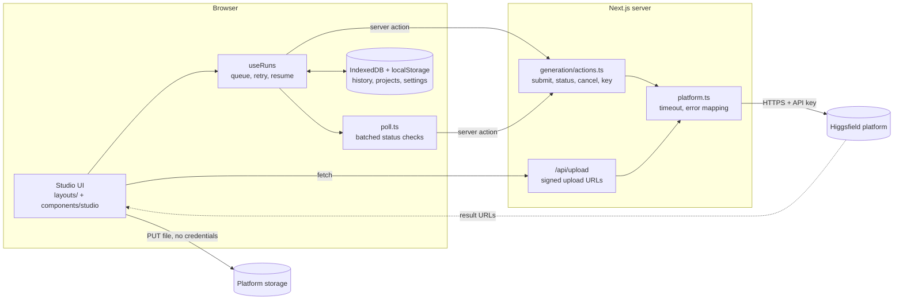

# Architecture

The API key lives in an httpOnly cookie and is only ever read by the server.
Reference files go from the browser straight to platform storage through a
signed URL. Results are loaded by the browser directly from the platform's CDN.

## Where things are

| Path                                     | Role                                                                        |
| ---------------------------------------- | --------------------------------------------------------------------------- |
| `layouts/studio.tsx`, `studio-views.tsx` | The Studio screen: state, handlers, Home and Feed                           |
| `components/studio/`                     | Building blocks (prompt box, gallery, viewer, dialogs). See its `AGENTS.md` |
| `components/studio/gallery/`             | Virtualised justified feed; private to `UserGenerations`                    |
| `generation/catalog/`                    | One file per model, generated barrel, settings parsing                      |
| `generation/actions.ts`, `platform.ts`   | The server boundary and the platform client                                 |
| `generation/poll.ts`                     | One batched status poll for every run in flight                             |
| `generation/mock-platform.ts`            | In-memory platform for tests and `HF_MOCK=1`                                |
| `lib/studio/use-runs.ts`                 | The run controller: queue, submit, retry, cancel, resume                    |
| `lib/studio/history.ts`, `kv.ts`         | IndexedDB persistence                                                       |
| `scripts/`                               | Model sync, env check, models diff, placeholder gate                        |

## Rules that keep it safe

- Authenticated platform calls stay on the server (`actions.ts`, `/api/upload`).
- Generate and Cancel both reach the platform; Cancel is not "stop polling".
- Browser code never touches `window`, `document` or storage during SSR.
- Nothing logs a prompt, URL, body or key (ESLint enforces it).
