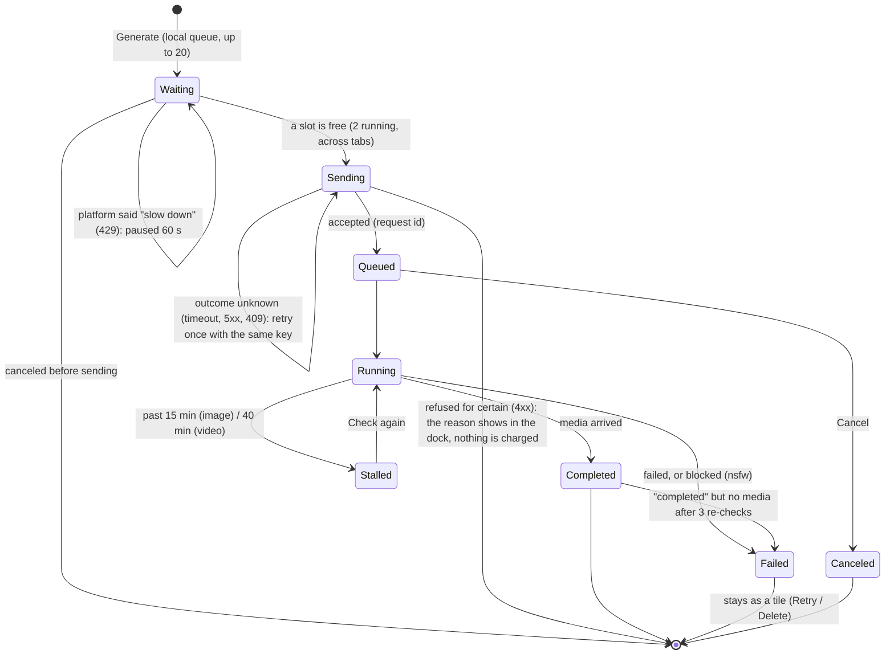

# Run lifecycle

## Guarantees

- **One click is at most one paid job.** Every submit carries an idempotency
  key. When the outcome is unknown the same key is reused for the retry, and a
  few such keys are remembered so editing the prompt cannot cause a duplicate.
- **One slow call never freezes the app.** Platform calls time out after 30 s;
  a timeout counts as "maybe it worked", not "failed".
- **Reload loses nothing.** Running runs resume their polls, the queue comes
  back for the tab that owned it, and a notice says what was recovered.
- **Status checks are batched.** One server action asks about every run in
  flight (50 ids at most per call). One failing group does not drop the rest.
- **Two tabs share the limit.** A Web Lock around "check slots, then send"
  stops both tabs taking the last slot.

## Where it happens

`lib/studio/use-runs.ts` (queue, submit, resume), `generation/poll.ts`
(polling), `generation/actions.ts` (server side), `generation/platform.ts`
(HTTP, timeouts), `lib/studio/pending-keys.ts` (idempotency keys).
